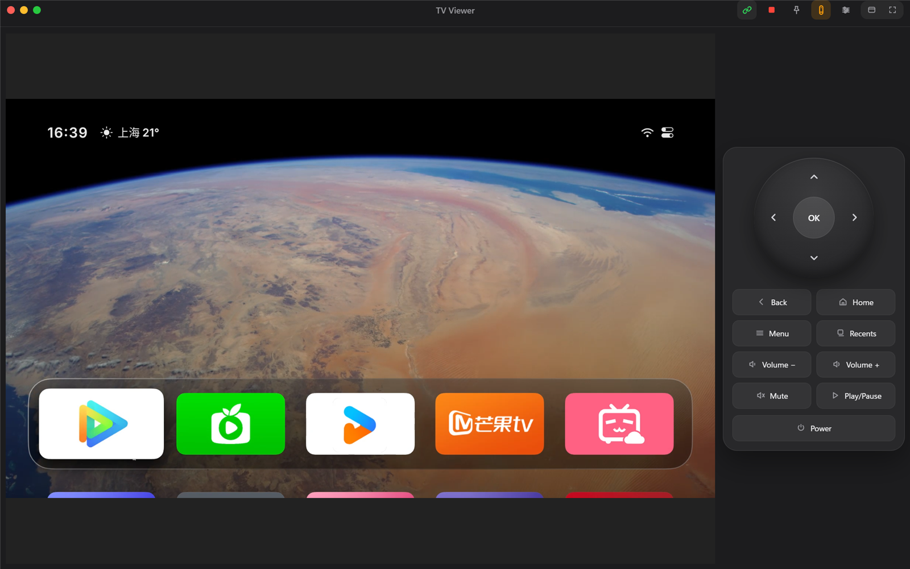

<p align="center">
  
</p>

<h1 align="center">TV Viewer</h1>

<p align="center">View and control an Android TV from a desktop window.</p>

<p align="center">
  
  
  
  
</p>

<p align="center">
  <a href="https://github.com/Chendongquan/tv-view/releases/latest"><b>Download</b></a>
  ·
  <a href="docs/TROUBLESHOOTING.md">Troubleshooting</a>
  ·
  <a href="README.md">中文</a>
</p>

---

TV Viewer embeds an Android TV picture in a desktop window and adds an on-screen remote. It uses ADB + scrcpy: nothing is installed on the TV, there is no account or relay server, and no root is required.

It is built for testing TV apps, adjusting UI and troubleshooting the TV from a PC instead of walking over to it.

## Features

- **One window**: the scrcpy picture is embedded in the app, not a floating window.
- **On-screen remote**: D-pad (hold to repeat), OK, Back, Home, Menu, Recents, volume ±, mute, play/pause, power; power always asks for confirmation.
- **Keyboard**: arrows, Enter and Backspace go straight to the TV; when the picture has focus, scrcpy shortcuts apply.
- **Window modes**: frameless, draggable top bar, keep on top, fill window, fullscreen, with global shortcuts.
- **Settings**: Chinese / English, connect on launch, reconnect after drop, D-pad repeat speed, keep on top, show remote.

## Quick start

### Installer (recommended)

#### 1. Install scrcpy (one-time)

The TV Viewer installer contains only the app; scrcpy and adb are installed separately. The Windows scrcpy package bundles adb:

```bash
winget install Genymobile.scrcpy
```

Verify:

```bash
scrcpy --version
adb version
```

#### 2. Download and install TV Viewer

Download from [GitHub Releases](https://github.com/Chendongquan/tv-view/releases):

- `tv-viewer-setup-<version>-x64.exe`: per-user installer with Start menu and desktop shortcuts; no administrator rights required.
- `tv-viewer-portable-<version>-x64.exe`: portable build; the first launch extracts to a temporary directory and is a little slower.

Optional: verify the download with `SHA256SUMS.txt`:

```powershell
Get-FileHash .\tv-viewer-setup-0.1.0-x64.exe -Algorithm SHA256
```

Run the installer and follow the wizard. The binaries are not code-signed, so Windows SmartScreen may warn about an unknown publisher; choose "More info → Run anyway" only if the file came from this repository's Releases.

#### 3. Connect the TV

1. Enable ADB debugging on the TV (Developer options → ADB debugging / network debugging).
2. Put the PC and the TV on the same LAN.
3. Open TV Viewer, enter the TV IP (port 5555 is appended automatically), and click Connect.
4. Accept the authorization dialog on the TV with its remote.
5. The picture takes over the stage and the remote lights up.

If it fails, see [Troubleshooting](docs/TROUBLESHOOTING.md).

#### Portable build

To skip installation, run `tv-viewer-portable-<version>-x64.exe`. It also requires scrcpy to be installed.

### Let an agent deploy the installer

Paste this into Claude Code or any coding agent that can run commands, and replace `<TV-IP>` with your TV address. It installs scrcpy, downloads and silently installs TV Viewer, launches it, and connects to the TV.

<details>
<summary>Show the agent prompt</summary>

```text
Install TV Viewer on this Windows PC and connect it to my Android TV.

1. Install scrcpy first (it is not bundled): winget install --id Genymobile.scrcpy --accept-source-agreements --accept-package-agreements, then confirm scrcpy --version and adb version work.
2. Download tv-viewer-setup-<latest version>-x64.exe and SHA256SUMS.txt from https://github.com/Chendongquan/tv-view/releases/latest into a temporary directory.
3. Verify the installer SHA256 against SHA256SUMS.txt; stop and tell me if it does not match.
4. Silent install: Start-Process -Wait -FilePath <installer> -ArgumentList '/S'.
   If SmartScreen or another security prompt blocks it, tell me first; do not force a bypass.
5. Find TV Viewer.exe under %LOCALAPPDATA%\Programs (or the Start menu shortcut) and launch it.
6. The TV is at <TV-IP> (port 5555 by default). Confirm ADB debugging is enabled on the TV and that it is on the same LAN as this PC.
7. Enter the IP in the app and click Connect; prompt me to accept the authorization dialog on the TV.
8. When it works, tell me the connected device, the available shortcuts, and how to enable "Connect on launch" in settings.

Do not install anything on the TV and do not introduce any third-party relay service.
If winget or the silent install is unavailable, tell me what is missing and give manual install steps first.
```

</details>

### Run from source (development)

Requirements: Windows 10/11, Node.js 22+, scrcpy (which bundles adb).

```bash
winget install Genymobile.scrcpy
cd app
npm install
npm start
```

ADB debugging must be enabled on the TV, and both devices must be on the same LAN. After the first install you can also double-click `app/tv-viewer.cmd`.

### CLI (optional)

```bash
./cli/tv-view.sh 192.168.50.33
./cli/tv-shot.sh before.png 192.168.50.33
```

Use `.cmd` (`cli\tv-view.cmd`, `cli\tv-shot.cmd`) in cmd / PowerShell. See [cli/README.md](cli/README.md) for full usage.

## Shortcuts

| Action | Shortcut |
| --- | --- |
| Show / hide remote | `Ctrl+Alt+H` |
| Fill window | `Ctrl+Alt+W` |
| Fullscreen | `Ctrl+Alt+F` or `Ctrl+Alt+Enter` |
| Exit fill / fullscreen | `Esc`, or the same shortcut again |
| Back | `Esc` when connected; `Alt+B` or right-click when the picture has focus |
| Home / recents | `Alt+H` / `Alt+S` when the picture has focus |

The MOD key is left Alt (or left Windows), not Ctrl. Ctrl combinations are forwarded to the TV app unchanged.

`Esc` priority: close settings → cancel power confirmation → exit fullscreen → exit fill-window → send Back.

## Verified

- Windows 11, 2560×1440 at 150% scaling.
- Xiaomi MFTR0, Android 11, 1920×1080.
- scrcpy 5.0.1, Electron 45.
- The packaged app and portable build launch correctly; the installer was built but not executed on this machine.

macOS, Linux and other TV models are not verified.

## FAQ

- **Do I need an app on the TV?** No. Only the system ADB service and the temporary scrcpy server.
- **Is ADB debugging required?** Yes. Picture, keys and screenshots all use ADB.
- **Is root required?** No.
- **Is there audio?** No; audio still comes from the TV.
- **macOS / Linux?** The CLI scripts work; the GUI with the embedded picture is Windows-only for now.
- **Android 4.x?** The picture requires Android 5.0+; 4.x is limited to screenshots via `cli/tv-shot`.
- **Two TVs at once?** One TV per window; multiple instances fight over the global shortcuts.

More answers and diagnostics: [Troubleshooting](docs/TROUBLESHOOTING.md).

## Limitations

- Do not use `--max-size=1600` on the verified Xiaomi TV; it corrupts the picture. Use `1280` or native.
- Use one scrcpy instance per TV.
- In fill-window / fullscreen the picture is a native child window and covers web controls; exit with shortcuts.
- The GUI uses the native resolution and has no bit-rate setting; use the CLI for lower bit rates.
- TV-side encoding uses the GPU/encoder; disconnect before measuring frame rate or animations.
- The installer does not include scrcpy / adb; install scrcpy first, or point `SCRCPY` / `ADB` at a custom version.
- The installer is not code-signed; SmartScreen may warn. Download only from this repository's Releases.

## Security & privacy

- ADB port 5555 is exposed on the LAN and protected only by RSA authorization. Do not enable it on untrusted networks or forward it to the internet.
- No telemetry, account or cloud; settings are stored locally in `%APPDATA%\TV Viewer\config.json`.
- The scrcpy server runs on the TV only while connected and leaves nothing installed.
- All operations go to the TV address you enter.
- Verify downloads with the SHA256 file in the release.

See [Security](SECURITY.md) for the threat model.

## Docs

| Document | Contents |
| --- | --- |
| [Troubleshooting](docs/TROUBLESHOOTING.md) | Connection, authorization, wireless debugging, embedding, keys, FAQ |
| [Development](docs/DEVELOPMENT.md) | Layout, IPC, window embedding, config, i18n, packaging |
| [App details](docs/APP.md) | UI, display modes, remote, settings |
| [Third-party notices](app/THIRD_PARTY_NOTICES.md) | scrcpy, adb and Electron licenses |
| [Design system](docs/DESIGN.md) | Colors, type, layout, components |
| [Product notes](docs/PRODUCT.md) | Users, positioning, scope |
| [Contributing](CONTRIBUTING.md) | Issues, PRs, code conventions |
| [Security](SECURITY.md) | Threat model and hardening |
| [Changelog](CHANGELOG.md) | Version history |

## Repository layout

<details>
<summary>Show the tree</summary>

```text
app/                    Electron app
  main.js                ADB / scrcpy / embedding / IPC / shortcuts
  preload.js             contextBridge API
  renderer.js            UI state, remote keys, window drag, stage rect
  embed-scrcpy.ps1       Win32 SetParent / MoveWindow, DPI aware
  index.html style.css   Frameless UI
  i18n.js                Chinese / English strings
  electron-builder.yml   Windows packaging
  build/ scripts/        Icon and build scripts
  THIRD_PARTY_NOTICES.md Third-party licenses shipped with the installer
cli/                    Command-line tools
  tv-view.sh / .cmd      CLI picture viewer
  tv-shot.sh / .cmd      CLI screenshot
  README.md              Usage
docs/                   Project documentation
  APP.md                 App details
  DESIGN.md              Design system
  PRODUCT.md             Product notes
  DEVELOPMENT.md         Development and packaging
  TROUBLESHOOTING.md     Troubleshooting
  images/                Hero image
  releases/              Release notes
```

The main process starts scrcpy; the renderer reports the stage rectangle over IPC; PowerShell uses `SetParent` to embed the scrcpy window and position it. Keys go through `adb shell input keyevent`, independent of the scrcpy window focus.

</details>

## Development

```bash
cd app
npm install
npm start       # development
npm run check   # node --check
```

Package the installer and portable build:

```bash
cd app
npm run dist           # artifacts in dist/
```

`dist/` is not committed. See [Development](docs/DEVELOPMENT.md) (Chinese).

## Contributing

Issues and pull requests are welcome; see [CONTRIBUTING.md](CONTRIBUTING.md). No TV-side app and no third-party relay service are hard constraints.

## License

[MIT](LICENSE)
