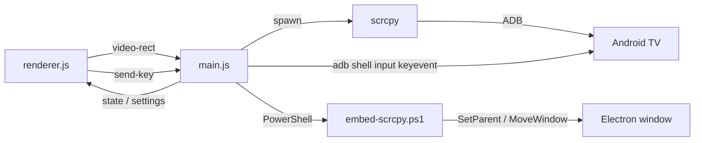

# 开发与构建

## 技术栈

- Electron 45，纯 JavaScript，没有前端框架、打包器或编译步骤。
- scrcpy 和 adb 是外部依赖，不随安装包分发；用户需要自己安装，应用按 `ADB` / `SCRCPY`、Android SDK、PATH 的顺序查找。
- 窗口嵌入使用 PowerShell 调 Win32 API，只在 Windows 上可用。

## 环境

- Node.js 22+
- npm
- scrcpy（源码运行时需要，建议 5.x，开发时使用 5.0.1）
- adb（scrcpy 的 Windows 包通常自带，或安装 Android SDK Platform-Tools）
- Windows 10 / 11（GUI）

## 启动

```bash
cd app
npm install
npm start
```

语法检查：

```bash
npm run check
```

它会依次对 `main.js`、`preload.js`、`renderer.js`、`i18n.js` 执行 `node --check`。

## 目录

```
app/
  main.js              主进程：adb / scrcpy / 窗口嵌入 / IPC / 快捷键 / 配置
  preload.js           contextBridge 白名单
  renderer.js          界面状态、遥控按键、窗口拖动、画面矩形上报
  index.html           无边框界面
  style.css            tvOS 风格深色样式
  i18n.js              中英文文案
  embed-scrcpy.ps1     SetParent / MoveWindow / DPI
  electron-builder.yml Windows 打包配置
  scripts/             make-icon.ps1
  build/               icon.ico、安装向导用的 LICENSE.txt
  dist/                打包产物（不提交）
  THIRD_PARTY_NOTICES.md
  tv-viewer.cmd        双击启动（需先 npm install）
cli/                   命令行工具
  tv-view.sh / .cmd    命令行查看画面
  tv-shot.sh / .cmd    命令行截图
  README.md            用法说明
docs/                  项目文档
  APP.md               应用细节
  DESIGN.md            设计系统
  PRODUCT.md           产品说明
  DEVELOPMENT.md       开发与构建
  TROUBLESHOOTING.md   故障排查
  images/              主图
  releases/            版本发布说明
```

## 进程模型

- **主进程**（`main.js`）：创建 `BrowserWindow`、查找 adb/scrcpy、连接电视、启动和停止 scrcpy、调用 PowerShell 嵌入窗口、注册全局快捷键、读写配置。
- **preload**（`preload.js`）：只通过 `contextBridge` 暴露 `window.tv` 上的白名单方法，不暴露 `ipcRenderer` 本身。
- **渲染进程**（`renderer.js`）：纯 DOM，不接触 Node。窗口配置为 `contextIsolation: true`、`nodeIntegration: false`，`index.html` 里还有 CSP（`script-src 'self'`）。

### IPC

渲染进程 → 主进程（`invoke`，有返回值）：

| 通道 | 作用 |
| --- | --- |
| `defaults` | 启动时的 serial、设置、版本 |
| `connect` | `adb connect` + `get-state` + 启动 scrcpy |
| `send-key` | `adb shell input keyevent` |
| `set-setting` | 修改并保存设置 |
| `set-settings-open` | 打开设置时隐藏原生视频 |
| `set-always-on-top` / `set-remote` / `set-window-fill` / `set-fullscreen` | 工具栏状态 |
| `window-control` | 最小化 / 关闭 / 全屏 |
| `stop` | 断开并停止 scrcpy |

渲染进程 → 主进程（`send`，无返回值）：`move-window-by`、`video-rect`。

主进程 → 渲染进程（事件）：`state`、`remote-visibility`、`window-fill`、`fullscreen`、`settings`。



## 窗口嵌入

1. `startScrcpy()` 以无边框、屏幕外位置启动 scrcpy，窗口标题固定为 `TvViewerVideo`。
2. 渲染进程用 `ResizeObserver` 和 `resize` 把 `#stage` 的 CSS 矩形（含 `devicePixelRatio`）通过 `video-rect` 发给主进程。
3. 主进程乘以 DPR，调用 `embed-scrcpy.ps1`：
   - 按 scrcpy 进程 PID 取 `MainWindowHandle`（最多等 20 秒），成功后缓存句柄；
   - 去掉 `WS_POPUP` / `WS_CAPTION` / `WS_THICKFRAME`，加上 `WS_CHILD`；
   - `SetParent` 到 Electron 窗口，`SetWindowPos` 定位，`ShowWindow` 显示。
4. 脚本先声明 Per-Monitor V2 DPI 感知（`SetProcessDpiAwarenessContext(-4)`），避免 150% 缩放下尺寸被二次放大。
5. 模式有 `embed` / `move` / `hide` / `show`。移动做了 120ms 防抖；嵌入后还会在 0.9s / 2.2s / 4s 重定位，覆盖 scrcpy 启动后自己调整窗口的情况。
6. 找不到父窗口或嵌入失败时返回 `floating`，界面进入 `warning`（画面单独打开），遥控器仍可用。

原生子窗口在 Z 序上永远高于网页层，所以满窗口 / 全屏时网页控件不可点击，退出依赖快捷键。

## 配置

路径：

```
%APPDATA%\TV Viewer\config.json
```

字段：

| 键 | 类型 | 默认 | 说明 |
| --- | --- | --- | --- |
| `serial` | string | — | 上次成功连接的电视地址 |
| `language` | `zh` / `en` | 系统语言 | 界面语言 |
| `autoConnect` | boolean | `false` | 启动时自动连接 |
| `autoReconnect` | boolean | `true` | scrcpy 异常退出后自动重连（最多 3 次） |
| `repeatFast` | boolean | `false` | 方向键连发速度 |
| `alwaysOnTop` | boolean | `false` | 窗口置顶 |
| `showRemote` | boolean | `true` | 显示遥控器 |

读取时会校验类型，坏值回落到默认值。旧的 `%APPDATA%\tv-viewer` 和 `%APPDATA%\tv-remote` 配置会在首次启动时迁移到新路径。

电源键**始终**弹二次确认，不是配置项。

## i18n

- `i18n.js` 定义 `window.TV_I18N = { zh: {...}, en: {...} }`。
- HTML 用 `data-i18n`（文本）、`data-i18n-title`（tooltip）、`data-i18n-aria`（aria-label）标记。
- `renderer.js` 的 `t(key, vars)` 取文案，支持 `{serial}` 这类占位符；缺 key 时回退显示 key 本身。
- 新增文案时同时补 `zh` 和 `en`，并在 HTML 里加对应 `data-i18n*`。可以用下面的命令检查两边 key 是否对齐：

```bash
cd app
node -e "global.window={};require('./i18n.js');const d=window.TV_I18N;const z=Object.keys(d.zh),e=Object.keys(d.en);console.log(z.length,e.length);console.log(z.filter(k=>!(k in d.en)),e.filter(k=>!(k in d.zh)))"
```

## 代码约定

- 保持无框架、无打包器，除非有明确理由。
- 渲染进程不接触 Node；新增能力先经 `preload.js` 白名单。
- 插入用户/设备数据一律用 `textContent`，不用 `innerHTML`。
- `set-setting` 只接受白名单键，新增设置项要同时改主进程白名单。
- Windows 相关代码集中在 `embed-scrcpy.ps1`，主进程里尽量保持平台无关。
- 注释只写非显而易见的约束，不解释代码字面。

## 打包

使用 electron-builder，配置在 `app/electron-builder.yml`。

1. 安装依赖：`npm install`
2. 图标已经提交在 `build/icon.ico`。改设计时运行 `npm run make-icon` 重新生成 PNG，再用仓库里的方式转成 ICO。
3. 构建：

```bash
npm run dist    # NSIS 安装版 + 便携版，产物在 dist/
npm run pack    # 只生成 dist/win-unpacked/，用于快速验证
```

产物：

- `dist/tv-viewer-setup-<version>-x64.exe`
- `dist/tv-viewer-portable-<version>-x64.exe`
- `dist/win-unpacked/`

打包后的 `resources/`：

- `app.asar`：应用代码；
- `app.asar.unpacked/embed-scrcpy.ps1`：PowerShell 必须能按真实路径执行，所以用 `asarUnpack` 解包；
- `THIRD_PARTY_NOTICES.md`、`LICENSE.txt`。

安装包不包含 scrcpy / adb，体积只包含 Electron 应用本身。运行时 `findAdb()` / `findScrcpy()` 按 `ADB` / `SCRCPY` 环境变量、Android SDK、PATH、WinGet 安装位置的顺序查找。`app.isPackaged` 为真时，`embed-scrcpy.ps1` 从 `app.asar.unpacked` 读取；开发运行时仍用 `app/` 下的文件。

许可证：scrcpy 和 adb 由用户自行安装，不随本应用分发，各自遵循 Apache-2.0；`THIRD_PARTY_NOTICES.md` 只说明依赖关系。Electron 的 MIT 许可见安装目录里的 Electron 许可文件。

签名：目前没有代码签名证书，electron-builder 会跳过签名，Windows SmartScreen 会提示未知发布者。以后签名可配置 `CSC_LINK` / `CSC_KEY_PASSWORD`，或 `win.certificateFile`。

自动更新：未配置，应用不会检查更新。

## 发布

1. 更新 `app/package.json` 的 `version` 和 `CHANGELOG.md`。
2. `cd app && npm run check`。
3. `npm run dist`，然后用 `git` 确认产物在 `dist/`（不提交）。
4. 生成校验文件：

```bash
cd app/dist
sha256sum *.exe > SHA256SUMS.txt
```

5. 提交源码，打 tag（例如 `v0.1.0`），推送。
6. 创建 GitHub Release，上传 `dist/*.exe` 和 `SHA256SUMS.txt`：

```bash
gh release create v0.1.0 dist/*.exe dist/SHA256SUMS.txt \
  --title "TV Viewer 0.1.0" \
  --notes-file /path/to/release-notes.md
```

## 平台

- GUI：仅 Windows（窗口嵌入依赖 `user32.dll`）。
- 命令行：Windows / macOS / Linux，只要能安装 scrcpy 和 adb。
- scrcpy 要求 Android 5.0+；Android 4.x 只能截图。
